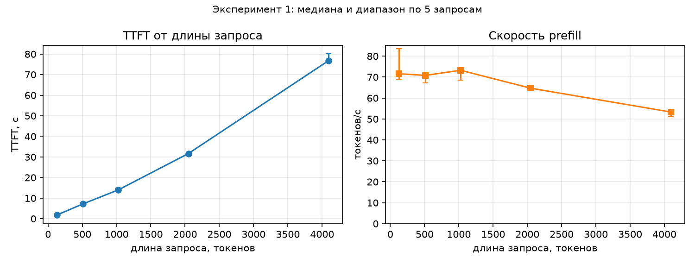
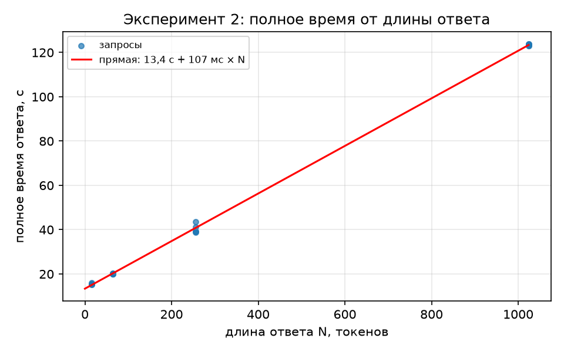
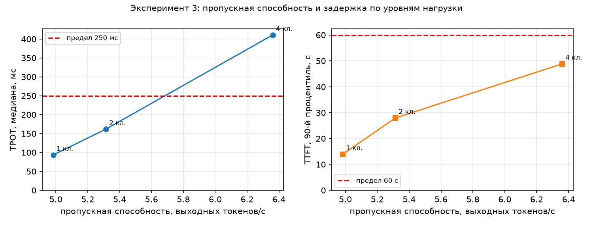

# Отчёт по ЛР1. Инференс и развёртывание языковой модели

> Файл собран скриптом `make_report.py` из шаблона `report/REPORT_template.md`. Все числа подставлены из `runs/`, `server/` и `mlflow.db`, вручную не переписывались.

## 1. Вопрос, профиль и прогноз

**Вопрос:** из чего складывается время ответа языковой модели и как оно меняется, когда пользователей становится много?

**Профиль CPU** (задание допускает GPU или CPU): сервер `llama-server` (llama.cpp), модель Qwen3-4B-Instruct-2507 в формате GGUF Q4_K_M, ноутбук с процессором 11th Gen Intel(R) Core(TM) i5-11400H @ 2.70GHz
(6 ядер, 12 потоков), 15,7 ГБ ОЗУ. Видеокарта RTX 3050 Ti имеет 4 ГБ, а веса модели в FP16 занимают 8,04 ГБ, vLLM на Windows не запускается, поэтому GPU-профиль недоступен.

Прогноз записан и закоммичен до итоговых запусков (коммит `00edf6e`, файл `hypothesis.md`). Он составлен по теории, в нём прямо сказано, что отладочные пробы при чужой нагрузке на CPU
дали лишь нижнюю оценку скорости. Сверка прогноза с результатом — в разделе 5.

## 2. Сервер и паспорт

| | Профиль 1 (опыты 1–2) | Профиль 2 (опыт 3) |
|---|---|---|
| Модель | Qwen/Qwen3-4B-Instruct-2507, ревизия `cdbee75f`, GGUF Q4_K_M от bartowski (`ae44f08e`), 2,50 ГБ | то же |
| Сервер | version: 0.9.0-dev (build 12182, commit fd27b2034) | version: 0.9.0-dev (build 12182, commit fd27b2034) |
| Контекст всего, токенов | 16384 | 16384 |
| Слотов | 1 | 4 |
| Контекст одного слота, токенов | 16384 | 4096 |
| KV-кеш из журнала | 2304 МиБ (16384 ячеек) | 2304 МиБ (4096 ячеек в слоте) |
| Потоков CPU | 6 | 6 |
| Устройство | CPU, `-ngl 0` | CPU, `-ngl 0` |

Команда запуска (профиль 1): `tools\llama\llama-server.exe -m models\Qwen_Qwen3-4B-Instruct-2507-Q4_K_M.gguf -c 16384 -np 1 -t 6 -ngl 0 --host 127.0.0.1 --port 8080 -a Qwen3-4B-Instruct-2507 --metrics -lv 4`. Профиль 2 отличается только `-np 4`. Полные паспорта — `server/passport_np1.json` и `server/passport_np4.json`, адрес сервера и параметры генерации по умолчанию — `endpoint.yaml`.
Флаг `-lv 4` включён для того, чтобы в журнале появились размер KV-кеша и параметры модели. Он добавляет по одной короткой строке журнала на каждый токен; по порядку величины это пренебрежимо на фоне 93 мс на токен, но влияние отдельно не измерялось.
Версии файлов и SHA-256 модели, архива llama.cpp и текста книги записаны в `data/manifest.json`.

## 3. Расчёт памяти

- **Веса.** Параметров 4,02 млрд. В FP16 это 4,02 · 2 байта ≈ **8,04 ГБ**. Файл GGUF Q4_K_M — **2,50 ГБ** (2,33 ГиБ), примерно в три раза меньше.
- **KV-кеш на токен** = 2 · слоёв · голов KV · размерность головы · байт на число = 2 · 36 · 8 · 128 · 2 = **147456 байт = 144 КиБ**
  (слои, головы и размерность взяты из журнала сервера и совпадают с конфигурацией модели).
- Контекст 16384 токенов занимает 2304 МиБ — ровно столько показывает журнал сервера (`llama_kv_cache: size`). Отношение «из журнала / по формуле» равно 1,00 (проверка `checks`).
- Для сравнения: 32 768 токенов в FP16 — 4,50 ГиБ.
- **Вопрос 3 к защите:** 8 пользователей по 4000 токенов = 8 · 4000 · 144 КиБ = **4,39 ГиБ**. На этом ноутбуке в ОЗУ (15,7 ГБ) это поместилось бы вместе с 2,3 ГиБ весов, а в видеопамять 4 ГБ — нет.
- Запрос 1024 + 128 токенов (опыт 3) занимает 162 МиБ. В общий контекст 16 384 токенов их поместилось бы 14, но при `-np 4` контекст делится на слоты (4096 токенов у каждого, `kv_unified = false`),
  и больше четырёх запросов обслуживать одновременно нельзя: лимитом служат слоты, а не память.

## 4. Результаты

Все замеры — температура 0, перед каждой серией один прогревочный запрос (в таблицы не входит), число токенов запроса и ответа проверено по `usage`: расхождение длины ответа с заданной — 0 в опыте 1 и 0 в опыте 2; длина запроса совпала с заданной (наибольшее отклонение 0 токенов).
Во всех записях основных серий `cache_n = 0`: кеш префикса не влиял на TTFT (уникальная метка в начале запроса и `cache_prompt: false`).
Перед каждым итоговым запуском загрузка процессора посторонними процессами была не выше 11,3 % (опыт 1), 12,7 % (опыт 2), 13,7 % (опыт 3).
Запуски: опыт 1 — `20261107-192623-exp1_prompt_length-e222ff`, кеш префикса — `20261107-193822-exp1_prefix_cache-66a822`, опыт 2 — `20261107-193915-exp2_output_length-7ec325`, опыт 3 — `20261107-195633-exp3_load-d93f74`.

### 4.1. Эксперимент 1. Длина запроса и TTFT

| Длина запроса, токенов | Запросов | Токенов по usage | TTFT, медиана, с | TTFT, мин–макс, с | Скорость prefill, ток/с | мин–макс | Ошибок |
|---|---|---|---|---|---|---|---|
| 128 | 5 | 128 | 1,79 | 1,53–1,86 | 71,6 | 69,0–83,5 | 0 |
| 512 | 5 | 512 | 7,23 | 7,13–7,61 | 70,8 | 67,3–71,8 | 0 |
| 1024 | 5 | 1024 | 13,98 | 13,92–14,94 | 73,3 | 68,5–73,6 | 0 |
| 2048 | 5 | 2048 | 31,66 | 31,08–31,98 | 64,7 | 64,0–65,9 | 0 |
| 4096 | 5 | 4096 | 76,85 | 75,88–80,31 | 53,3 | 51,0–54,0 | 0 |

*Таблица 1. Серия `exp1_prompt_length`: 5 запросов на длину, ответ 16 токенов, один слот. TTFT и скорость prefill — медиана и диапазон.*

**Рисунок 1.** TTFT от длины запроса и скорость prefill.

- TTFT растёт с длиной запроса: от 1,79 с на 128 токенах до 76,8 с на 4096. Длина выросла в 32,0 раза, TTFT — в 43,0 раза, то есть чуть быстрее линейного.
- Скорость prefill почти постоянна, **70,8–73,3 токенов/с**, на 128–1024 токенах, потом падает: 64,7 токенов/с на 2048 и **53,3 на 4096** (0,73 от максимума 73,3). Причина: стоимость внимания растёт как квадрат длины, и на длинных запросах эта часть перестаёт быть малой.
  Prefill упирается в вычисления, поэтому токены обрабатываются «пачкой» на постоянной скорости.

**Кеширование префикса.** Один и тот же запрос на 2048 токенов отправлен три раза подряд (серия `exp1_prefix_cache`, кеш включён).

| Попытка | TTFT, с | Токенов запроса | Из кеша, токенов | Обработано, токенов |
|---|---|---|---|---|
| 1 | 34,47 | 2048 | 123 | 1925 |
| 2 | 0,14 | 2048 | 2047 | 1 |
| 3 | 0,14 | 2048 | 2047 | 1 |

*Таблица 2. Кеш префикса. «Из кеша» — `cache_n` из ответа сервера.*

TTFT со второго раза упал с **34,5 с до 0,14 с, то есть в 253 раза** (с третьего — в 250 раз): сервер взял готовый KV-кеш (2047 токенов из 2048) и обработал только последний токен.
Замечание: в первой попытке `cache_n` = 123 — часть начала запроса совпала с прогревочным запросом той же книги и была взята из кеша, так что холодный TTFT на деле чуть больше (на ≈ 6 %); на вывод это не влияет.
Для агента из ЛР4 это главное: в каждом вызове передаются описания 24 инструментов (около 4000 токенов), и если они стоят в начале запроса, а не меняются, то prefill на них оплачивается один раз, а не на каждом шаге.

### 4.2. Эксперимент 2. Длина ответа и скорость генерации

| Длина ответа, токенов | Запросов | Токенов по usage | Полное время, медиана, с | мин–макс, с | TTFT, медиана, с | TPOT, медиана, мс | Ошибок |
|---|---|---|---|---|---|---|---|
| 16 | 5 | 16 | 15,47 | 15,29–16,05 | 14,09 | 92 | 0 |
| 64 | 5 | 64 | 20,11 | 20,09–20,24 | 14,34 | 92 | 0 |
| 256 | 5 | 256 | 39,30 | 38,89–43,54 | 15,21 | 95 | 0 |
| 1024 | 5 | 1024 | 123,68 | 122,99–123,86 | 16,44 | 105 | 0 |

*Таблица 3. Серия `exp2_output_length`: запрос 1024 токена, ответ с `ignore_eos`, 5 запросов на длину, один слот.*

**Рисунок 2.** Полное время ответа от длины ответа и прямая по методу наименьших квадратов (по всем запросам).

- Прямая: **время = 13,4 с + 107 мс × N** (R² > 0,999). Свободный член 13,4 с близок к TTFT запроса в 1024 токена (14,9 с в этой серии, 14,0 с в опыте 1). Наклон 107 мс чуть выше медианы TPOT (93,0 мс, то есть 10,8 токенов/с): TPOT слегка растёт с длиной ответа (см. ниже).
- TPOT слабо зависит от длины ответа: 91,6 мс на 16 токенах и 105 мс на 1024 (около +14 %). Причина роста — на каждом шаге читается ещё и растущий KV-кеш; длина ответа в 64 раза меняет TPOT лишь на седьмую часть.
- **Сравнение с нижней границей п. 2.1.** Веса 2,50 ГБ, пропускная способность памяти двухканальной DDR4-3200 — теоретически 51,2 ГБ/с (предположение: оба модуля стоят в разных каналах). Нижняя граница — 48,8 мс на токен (20,5 токенов/с).
  Измеренный TPOT в **1,91 раза** выше: эффективная скорость чтения весов — 26,8 ГБ/с, примерно половина теоретического максимума. Остальное уходит на чтение KV-кеша, вычисления (деквантование, внимание) и накладные расходы потоков.

### 4.3. Эксперимент 3. Нагрузка

Пределы для интерактивного ассистента на CPU заданы до опыта (`hypothesis.md`): **TTFT у 90 % запросов не больше 60,0 с, медиана TPOT не больше 250 мс**.
Уровни — 1, 2 и 4 клиента, 4 слота; на уровне max(16, 4n) = 16 запросов по 1024 токена с разным текстом, ответ 128 токенов. Метрики сервера `/metrics` снимались до, во время (каждые 2 с) и после каждого уровня.

| Клиентов | Запросов | Время уровня, с | Пропускная способность, ток/с | Запросов/с | TTFT, медиана, с | TTFT, p90, с | TPOT, медиана, мс | Goodput, запр./с | Макс. в очереди | Макс. токенов в слоте | В пределах |
|---|---|---|---|---|---|---|---|---|---|---|---|
| 1 | 16 | 411 | 4,98 | 0,039 | 13,8 | 13,9 | 93 | 0,039 | 0 | 1151 | да |
| 2 | 16 | 385 | 5,31 | 0,042 | 27,6 | 27,9 | 162 | 0,042 | 0 | 1151 | да |
| 4 | 16 | 322 | 6,36 | 0,050 | 28,5 | 48,8 | 411 | 0,006 | 0 | 1151 | нет |

*Таблица 4. Серия `exp3_load`. Goodput — запросов в секунду, у которых одновременно TTFT и TPOT в пределах. «Макс. в очереди» — максимум `llamacpp:requests_deferred`; в этой сборке сервер не отдаёт заполнение KV-кеша, поэтому показан максимум токенов в слоте (`llamacpp:n_tokens_max`), слот вмещает 4096 токенов.*

**Рисунок 3.** «Пропускная способность — задержка»: TPOT (слева) и 90-й процентиль TTFT (справа) по уровням нагрузки; пунктир — пределы.

- **Пропускная способность растёт слабо**: 4,98 → 5,31 → 6,36 токенов/с, всего в 1,28 раза при четырёх клиентах. **Задержка растёт сильно**: p90 TTFT в 3,50 раза, медиана TPOT в **4,40 раза**.
- **Почему так.** Время уровня складывается из prefill и decode. Prefill — вычисления, запросы разных клиентов обрабатываются по очереди и от числа клиентов не ускоряются: 221 с на 16 запросов (13,8 с каждый, как у одного клиента).
  Доля prefill во времени уровня: 0,54 при одном клиенте и **0,69 при четырёх**. Остальное — decode: 190 с → 165 с → 101 с.
  Проверка модели: при одном клиенте по ней выходит 93,7 мс на токен, измеренный TPOT — 93,4 мс. Decode ускоряется батчем (веса читаются один раз на несколько запросов), но только в 1,88 раза при четырёх клиентах, а не в четыре, потому что часть времени занята prefill соседних запросов, и decode-шаг идёт не всегда полным батчем.
  Итог: суммарно выигрыш 1,28 раза. TPOT растёт сильнее всего, потому что токены одного запроса выходят по одному, а между ними процессор успевает обработать куски чужих запросов на prefill.
- **Какие пределы выполняются.** На 1 и 2 клиентах выполняются оба (TTFT p90 13,9 и 27,9 с, TPOT 93,4 и 162 мс). **На 4 клиентах не выполняется предел по TPOT** (411 мс против 250 мс), хотя p90 TTFT (48,8 с) ещё укладывается. Goodput на 4 клиентах — 0,006 запросов/с: в пределы по обоим показателям попали только 2 запросов из 16.
  **Наибольшая нагрузка в пределах — 2 клиента.**
- **Очередь и KV-кеш.** Запросы в очередь не вставали (`requests_deferred` = 0): клиентов не больше слотов. Слот заполнялся максимум на 28,1 % (1151 из 4096 токенов). В KV-кеш общего контекста поместилось бы 14 запросов по 1152 токена, а слотов четыре, поэтому лимитом стали вычисления.
  Момент, когда запросы начнут ждать в очереди, при этих уровнях не достигнут; он наступил бы при 5 клиентах и больше.

## 5. Сверка с прогнозом

| Прогноз | Результат | Вывод |
|---|---|---|
| TTFT растёт почти линейно, на длинных запросах чуть быстрее | в 32,0 раза по длине → в 43,0 раза по TTFT | подтвердился |
| скорость prefill на 512–1024 токенах 25–80 ток/с | 70,8 и 73,3 ток/с | подтвердился (у верхней границы) |
| на 128 токенах скорость prefill ниже из-за накладных расходов | 71,6 ток/с, как на 512–1024 | **не подтвердился** |
| на 4096 токенах скорость ниже максимума на 10–30 % | ниже на 27 % (53,3 ток/с) | подтвердился |
| TTFT запроса в 1024 токена порядка 13–40 с | 14,0 с | подтвердился (у нижней границы) |
| кеш префикса: TTFT со второго раза меньше «в десятки раз» (не меньше чем в 10) | в 253 раза | подтвердился по нижней границе, но недооценён на порядок |
| полное время — прямая, свободный член ≈ TTFT, наклон ≈ TPOT | 13,4 с и 107 мс | подтвердился |
| TPOT 80–250 мс (4–12 ток/с), хуже нижней границы в 1,5–5 раз | 93,0 мс (10,8 ток/с), в 1,91 раза | подтвердился (у нижней границы диапазона) |
| пропускная способность от 1 к 4 клиентам выше в 1,2–2 раза | в 1,28 раза | подтвердился |
| p90 TTFT при 4 клиентах в 3–4 раза выше, чем при одном | в 3,50 раза | подтвердился |
| медиана TPOT растёт в 1,3–2,5 раза | в **4,40 раза** | **не подтвердился** (недооценён: не учтено, что decode-шаги перемежаются prefill соседей) |
| пределы выполняются на 1 и, вероятно, на 2 клиентах, на 4 перестают — по TTFT | на 1 и 2 выполняются; на 4 не выполняется **TPOT**, TTFT укладывается | наибольшая нагрузка угадана (2 клиента), причина названа неверно |
| очередь пуста, KV-кеш не лимитирует | `requests_deferred` = 0, слот занят на 28,1 % | подтвердился |
| запрос 1152 токена занимает 166 МиБ | расчёт даёт 162 МиБ | арифметическая ошибка в прогнозе (1152 · 144 КиБ = 162 МиБ) |

## 6. Выводы

**Из чего складывается время ответа.** Время до первого токена — это prefill: на этом процессоре около 73,3 токена/с, значит запрос в 1024 токена ждёт 14,0 с, а в 4096 токенов — 76,8 с, и TTFT растёт с длиной запроса чуть быстрее линейного.
Дальше токены выходят по одному со скоростью около 10,8 токенов/с (TPOT 93,0 мс), почти независимо от длины ответа: ответ в 256 токенов — ещё около 24 с. Prefill упирается в вычисления, decode — в пропускную способность памяти (измеренный TPOT вдвое хуже теоретического предела).

**Сколько пользователей выдерживает сервер.** По принятым пределам (TTFT p90 ≤ 60,0 с, медиана TPOT ≤ 250 мс) — **2 одновременных клиента** с запросами по 1024 токена. Четвёртый клиент превращает сервер в «медленный»: TPOT растёт в 4,40 раза, а суммарная пропускная способность — только в 1,28 раза.
Для запросов, где prefill доминирует, добавлять клиентов бессмысленно: prefill последовательный, и батч помогает только decode.

**Что это значит для ЛР2–ЛР8** (оценки на этом оборудовании):
- RAG из ЛР2: запрос с тремя документами, около 2000 токенов, ждёт первого токена около 31,7 с, ответ в 100 токенов — ещё около 9 с. Серии нужно планировать минутами на запись, а не секундами.
- Агент из ЛР4: описания 24 инструментов, около 4000 токенов в каждом вызове, при холодном кеше стоят около 76,8 с на prefill. Если описания стоят в начале запроса, кеш префикса сводит повторную обработку почти к нулю (2048 токенов: 0,14 с вместо 34,5 с). **Начало запроса надо держать неизменным** и не вставлять в него метки, даты и номера шагов.
- Для примера: если эпизод агента — 5 вызовов модели, то без кеша только на prefill уйдёт 5 · 76,8 с, около 6,4 минуты; с кешем — первый вызов плюс небольшие добавки. Это прикидка, а не измерение.
- Серии ЛР4–ЛР8 нужно выполнять по одному клиенту, повторные прогоны и параллельные эпизоды не ускорят работу, пока они упираются в prefill. При необходимости быстрее — нужна видеокарта (GPU-профиль, Colab T4) или меньшая модель.
- Эталонные числа этой работы (скорость prefill, TPOT) годятся для оценки длительности серий и должны пересчитываться при смене модели, квантования или оборудования: вывод относится только к этому ноутбуку.

## 7. Границы выводов

- Один ноутбук, один процессор, одна модель и один формат квантования (Q4_K_M); 6 потоков (`-t 6`). По `llama-bench` на 12 потоках prefill быстрее (50 против 30 ток/с при чужой нагрузке), но эта настройка не исследовалась.
- Пять запросов на длину и 16 запросов на уровень нагрузки, серии повторялись по одному разу. Разброс по повторам мал (диапазоны в таблицах), но температурный режим ноутбука и фоновые службы Windows на замеры не контролировались; загрузка CPU посторонними процессами измерена до и после запуска.
- Серия `checks` выполнялась при загрузке CPU около 87 %: она проверяет корректность (длина, повтор, KV-кеш), а не время, и в таблицы не входит.
- Пределы (60 с и 250 мс) выбраны по смыслу интерактивной работы на CPU; при других пределах «наибольшая нагрузка» была бы другой. Три уровня — 1, 2 и 4 клиента; поведение при очереди (клиентов больше слотов) не измерялось.
- Оценка нижней границы TPOT опирается на предположение о двух каналах памяти (51,2 ГБ/с); если канал один, граница вдвое выше, и измеренный TPOT окажется почти на ней.
- Повторяемость при температуре 0 проверена одним случаем (один слот, без кеша): тексты совпали. На нескольких клиентах (разная группировка в батчи) это могло бы не выполняться; не проверялось.

## 8. Кодогенерация

Код клиента-измерителя, генератора запросов, управления сервером, скрипта отчёта и тестов написан с помощью ИИ-ассистента (Claude) и проверен так:
- 18 автоматических тестов (`pytest`) на сервере-заглушке, в том числе арифметика метрик на известных отметках (t0 = 0, t1 = 0,4 с, tN = 2,4 с, N = 101 → TTFT 400 мс, TPOT 20 мс), разбор потока (число токенов берётся из `usage`, а не из числа фрагментов), ошибка запроса записывается, а не теряется, температура и параметры передаются явно, отказ запуска при грязном git-дереве и при неверном числе слотов;
- три проверки на настоящем сервере (серия `checks`): `max_tokens = 64` с `ignore_eos` вернул ровно 64 токена, один и тот же запрос при температуре 0 дважды дал одинаковый текст, размер KV-кеша из журнала равен числу ячеек × 144 КиБ;
- типичные ошибки сгенерированного кода проверены явно: таймер ставится вокруг запроса (`time.perf_counter`, t0 перед отправкой, t1 на первом фрагменте с текстом, запись файлов вне интервала); знаменатель — все запланированные запросы, ошибки остаются в результатах; длина запроса и ответа проверяются по `usage` (расхождений нет), в статистику не попадают прогрев и калибровка, `cache_n = 0` во всех записях основных серий; сводки пересчитываются из `results.jsonl`;
- модель и сервер зафиксированы SHA-256 (хеш модели совпал с хешем на Hugging Face), текст книги хешируется по тем же байтам, которые читаются.

## Артефакты

`runs/`, `server_logs/`, `mlflow.db` и `mlruns/` не хранятся в git и сдаются архивом `lr1_artifacts.zip`. Таблицы — `report/*.csv`, графики — `report/*.png`, числа — `report/numbers.json`.
Пересчитать отчёт: `python make_report.py`.
