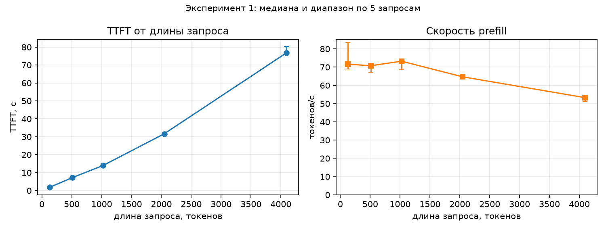
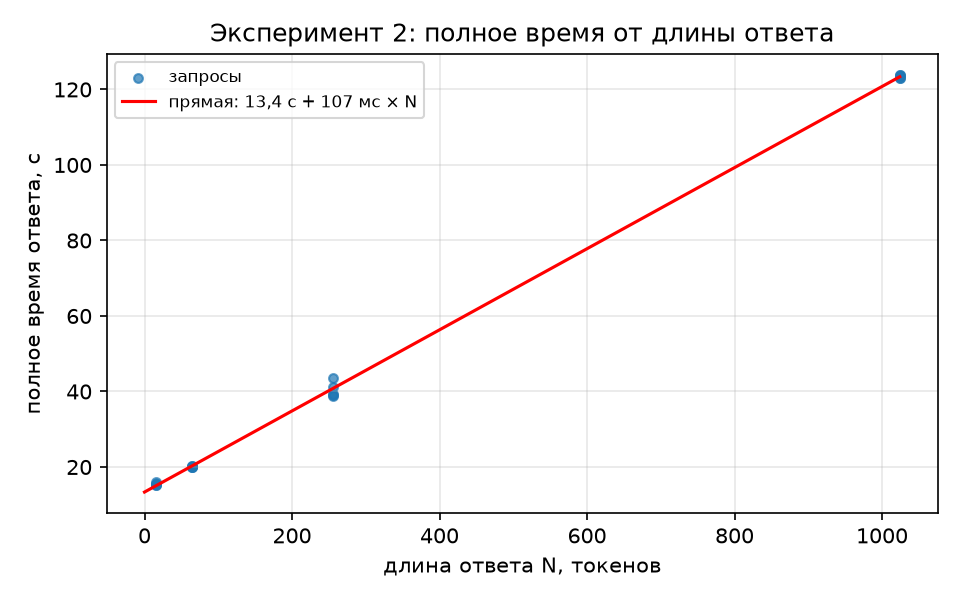
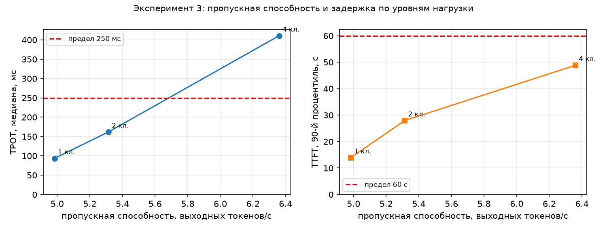

# Отчёт по ЛР1. Инференс и развёртывание языковой модели

> Файл собран скриптом `make_report.py` из шаблона `report/REPORT_template.md`. Все числа подставлены из `runs/`, `server/` и `mlflow.db`, вручную не переписывались.

## 1. Вопрос, профиль и прогноз

**Вопрос:** из чего складывается время ответа языковой модели и как оно меняется, когда пользователей становится много?

**Профиль CPU** (задание допускает GPU или CPU): сервер `llama-server` (llama.cpp), модель Qwen3-4B-Instruct-2507 в формате GGUF Q4_K_M, ноутбук с процессором $hardware_cpu
($hardware_cores ядер, $hardware_threads потоков), $hardware_ram_gb ГБ ОЗУ. Видеокарта RTX 3050 Ti имеет 4 ГБ, а веса модели в FP16 занимают $memory_weights_fp16_gb ГБ, vLLM на Windows не запускается, поэтому GPU-профиль недоступен.

Прогноз записан и закоммичен до итоговых запусков (коммит `00edf6e`, файл `hypothesis.md`). Он составлен по теории, в нём прямо сказано, что отладочные пробы при чужой нагрузке на CPU
дали лишь нижнюю оценку скорости. Сверка прогноза с результатом — в разделе 5.

## 2. Сервер и паспорт

| | Профиль 1 (опыты 1–2) | Профиль 2 (опыт 3) |
|---|---|---|
| Модель | Qwen/Qwen3-4B-Instruct-2507, ревизия `cdbee75f`, GGUF Q4_K_M от bartowski (`ae44f08e`), 2,50 ГБ | то же |
| Сервер | $server_1_version | $server_4_version |
| Контекст всего, токенов | $server_1_ctx_total | $server_4_ctx_total |
| Слотов | $server_1_slots | $server_4_slots |
| Контекст одного слота, токенов | $server_1_n_ctx_seq | $server_4_n_ctx_seq |
| KV-кеш из журнала | $server_1_kv_size_mib МиБ ($server_1_kv_cells ячеек) | $server_4_kv_size_mib МиБ ($server_4_kv_cells ячеек в слоте) |
| Потоков CPU | $server_1_threads | $server_4_threads |
| Устройство | CPU, `-ngl 0` | CPU, `-ngl 0` |

Команда запуска (профиль 1): `$server_1_command`. Профиль 2 отличается только `-np 4`. Полные паспорта — `server/passport_np1.json` и `server/passport_np4.json`, адрес сервера и параметры генерации по умолчанию — `endpoint.yaml`.
Флаг `-lv 4` включён для того, чтобы в журнале появились размер KV-кеша и параметры модели. Он добавляет по одной короткой строке журнала на каждый токен; по порядку величины это пренебрежимо на фоне 93 мс на токен, но влияние отдельно не измерялось.
Версии файлов и SHA-256 модели, архива llama.cpp и текста книги записаны в `data/manifest.json`.

## 3. Расчёт памяти

- **Веса.** Параметров $memory_params_b млрд. В FP16 это $memory_params_b · 2 байта ≈ **$memory_weights_fp16_gb ГБ**. Файл GGUF Q4_K_M — **$memory_weights_gguf_gb ГБ** ($memory_weights_gguf_gib ГиБ), примерно в три раза меньше.
- **KV-кеш на токен** = 2 · слоёв · голов KV · размерность головы · байт на число = 2 · $memory_n_layer · $memory_n_head_kv · $memory_head_dim · 2 = **$memory_kv_bytes_per_token байт = $memory_kv_kib_per_token КиБ**
  (слои, головы и размерность взяты из журнала сервера и совпадают с конфигурацией модели).
- Контекст $memory_kv_ctx_total_tokens токенов занимает $memory_kv_ctx_total_mib МиБ — ровно столько показывает журнал сервера (`llama_kv_cache: size`). Отношение «из журнала / по формуле» равно 1,00 (проверка `checks`).
- Для сравнения: 32 768 токенов в FP16 — $memory_kv_32768_gib ГиБ.
- **Вопрос 3 к защите:** 8 пользователей по 4000 токенов = 8 · 4000 · 144 КиБ = **$memory_kv_8x4000_gib ГиБ**. На этом ноутбуке в ОЗУ (15,7 ГБ) это поместилось бы вместе с 2,3 ГиБ весов, а в видеопамять 4 ГБ — нет.
- Запрос 1024 + 128 токенов (опыт 3) занимает $memory_kv_per_request_1152_mib МиБ. В общий контекст 16 384 токенов их поместилось бы $memory_requests_1152_in_total_ctx, но при `-np 4` контекст делится на слоты ($server_4_n_ctx_seq токенов у каждого, `kv_unified = false`),
  и больше четырёх запросов обслуживать одновременно нельзя: лимитом служат слоты, а не память.

## 4. Результаты

Все замеры — температура 0, перед каждой серией один прогревочный запрос (в таблицы не входит), число токенов запроса и ответа проверено по `usage`: расхождение длины ответа с заданной — $exp1_length_mismatch в опыте 1 и $exp2_length_mismatch в опыте 2; длина запроса совпала с заданной (наибольшее отклонение $exp1_max_prompt_deviation токенов).
Во всех записях основных серий `cache_n = 0`: кеш префикса не влиял на TTFT (уникальная метка в начале запроса и `cache_prompt: false`).
Перед каждым итоговым запуском загрузка процессора посторонними процессами была не выше $cpu_load_before_exp1_prompt_length % (опыт 1), $cpu_load_before_exp2_output_length % (опыт 2), $cpu_load_before_exp3_load % (опыт 3).
Запуски: опыт 1 — `$series_exp1_prompt_length`, кеш префикса — `$series_exp1_prefix_cache`, опыт 2 — `$series_exp2_output_length`, опыт 3 — `$series_exp3_load`.

### 4.1. Эксперимент 1. Длина запроса и TTFT

$exp1_table

*Таблица 1. Серия `exp1_prompt_length`: 5 запросов на длину, ответ 16 токенов, один слот. TTFT и скорость prefill — медиана и диапазон.*

**Рисунок 1.** TTFT от длины запроса и скорость prefill.

- TTFT растёт с длиной запроса: от $exp1_ttft_by_len_128 с на 128 токенах до $exp1_ttft_by_len_4096 с на 4096. Длина выросла в $exp1_length_ratio_last_first раза, TTFT — в $exp1_ttft_ratio_last_first раза, то есть чуть быстрее линейного.
- Скорость prefill почти постоянна, **$exp1_prefill_by_len_512–$exp1_prefill_by_len_1024 токенов/с**, на 128–1024 токенах, потом падает: $exp1_prefill_by_len_2048 токенов/с на 2048 и **$exp1_prefill_last на 4096** ($exp1_prefill_last_to_peak от максимума $exp1_prefill_peak). Причина: стоимость внимания растёт как квадрат длины, и на длинных запросах эта часть перестаёт быть малой.
  Prefill упирается в вычисления, поэтому токены обрабатываются «пачкой» на постоянной скорости.

**Кеширование префикса.** Один и тот же запрос на $prefix_prompt_tokens токенов отправлен три раза подряд (серия `exp1_prefix_cache`, кеш включён).

$prefix_table

*Таблица 2. Кеш префикса. «Из кеша» — `cache_n` из ответа сервера.*

TTFT со второго раза упал с **$prefix_t1 с до $prefix_t2 с, то есть в $prefix_ratio_1_2 раза** (с третьего — в $prefix_ratio_1_3 раз): сервер взял готовый KV-кеш ($prefix_cache_second токенов из $prefix_prompt_tokens) и обработал только последний токен.
Замечание: в первой попытке `cache_n` = $prefix_cache_first — часть начала запроса совпала с прогревочным запросом той же книги и была взята из кеша, так что холодный TTFT на деле чуть больше (на ≈ 6 %); на вывод это не влияет.
Для агента из ЛР4 это главное: в каждом вызове передаются описания 24 инструментов (около 4000 токенов), и если они стоят в начале запроса, а не меняются, то prefill на них оплачивается один раз, а не на каждом шаге.

### 4.2. Эксперимент 2. Длина ответа и скорость генерации

$exp2_table

*Таблица 3. Серия `exp2_output_length`: запрос 1024 токена, ответ с `ignore_eos`, 5 запросов на длину, один слот.*

**Рисунок 2.** Полное время ответа от длины ответа и прямая по методу наименьших квадратов (по всем запросам).

- Прямая: **время = $exp2_intercept_s с + $exp2_slope_ms мс × N** (R² > 0,999). Свободный член $exp2_intercept_s с близок к TTFT запроса в 1024 токена ($exp2_ttft_median_s с в этой серии, $exp1_ttft_by_len_1024 с в опыте 1). Наклон $exp2_slope_ms мс чуть выше медианы TPOT ($exp2_tpot_median_ms мс, то есть $exp2_tok_s токенов/с): TPOT слегка растёт с длиной ответа (см. ниже).
- TPOT слабо зависит от длины ответа: $exp2_by_output_16_tpot_median_ms мс на 16 токенах и $exp2_by_output_1024_tpot_median_ms мс на 1024 (около +14 %). Причина роста — на каждом шаге читается ещё и растущий KV-кеш; длина ответа в 64 раза меняет TPOT лишь на седьмую часть.
- **Сравнение с нижней границей п. 2.1.** Веса $memory_weights_gguf_gb ГБ, пропускная способность памяти двухканальной DDR4-3200 — теоретически $exp2_bandwidth_gb_s_assumed ГБ/с (предположение: оба модуля стоят в разных каналах). Нижняя граница — $exp2_tpot_lower_bound_ms мс на токен ($exp2_tok_s_upper_bound токенов/с).
  Измеренный TPOT в **$exp2_tpot_over_bound раза** выше: эффективная скорость чтения весов — $exp2_effective_bandwidth_gb_s ГБ/с, примерно половина теоретического максимума. Остальное уходит на чтение KV-кеша, вычисления (деквантование, внимание) и накладные расходы потоков.

### 4.3. Эксперимент 3. Нагрузка

Пределы для интерактивного ассистента на CPU заданы до опыта (`hypothesis.md`): **TTFT у 90 % запросов не больше $exp3_ttft_limit_s с, медиана TPOT не больше $exp3_tpot_limit_ms мс**.
Уровни — 1, 2 и 4 клиента, 4 слота; на уровне max(16, 4n) = 16 запросов по 1024 токена с разным текстом, ответ 128 токенов. Метрики сервера `/metrics` снимались до, во время (каждые 2 с) и после каждого уровня.

$exp3_table

*Таблица 4. Серия `exp3_load`. Goodput — запросов в секунду, у которых одновременно TTFT и TPOT в пределах. «Макс. в очереди» — максимум `llamacpp:requests_deferred`; в этой сборке сервер не отдаёт заполнение KV-кеша, поэтому показан максимум токенов в слоте (`llamacpp:n_tokens_max`), слот вмещает $server_4_n_ctx_seq токенов.*

**Рисунок 3.** «Пропускная способность — задержка»: TPOT (слева) и 90-й процентиль TTFT (справа) по уровням нагрузки; пунктир — пределы.

- **Пропускная способность растёт слабо**: $exp3_lv_1_throughput → $exp3_lv_2_throughput → $exp3_lv_4_throughput токенов/с, всего в $exp3_throughput_gain_last_first раза при четырёх клиентах. **Задержка растёт сильно**: p90 TTFT в $exp3_ttft_ratio_last_first раза, медиана TPOT в **$exp3_tpot_ratio_last_first раза**.
- **Почему так.** Время уровня складывается из prefill и decode. Prefill — вычисления, запросы разных клиентов обрабатываются по очереди и от числа клиентов не ускоряются: $exp3_lv_1_prefill_total_s с на 16 запросов ($exp3_t_prefill_single с каждый, как у одного клиента).
  Доля prefill во времени уровня: $exp3_lv_1_prefill_share при одном клиенте и **$exp3_lv_4_prefill_share при четырёх**. Остальное — decode: $exp3_lv_1_decode_part_s с → $exp3_lv_2_decode_part_s с → $exp3_lv_4_decode_part_s с.
  Проверка модели: при одном клиенте по ней выходит $exp3_lv_1_decode_ms_per_token мс на токен, измеренный TPOT — $exp3_lv_1_tpot_median_ms мс. Decode ускоряется батчем (веса читаются один раз на несколько запросов), но только в $exp3_lv_4_decode_speedup раза при четырёх клиентах, а не в четыре, потому что часть времени занята prefill соседних запросов, и decode-шаг идёт не всегда полным батчем.
  Итог: суммарно выигрыш $exp3_throughput_gain_last_first раза. TPOT растёт сильнее всего, потому что токены одного запроса выходят по одному, а между ними процессор успевает обработать куски чужих запросов на prefill.
- **Какие пределы выполняются.** На 1 и 2 клиентах выполняются оба (TTFT p90 $exp3_lv_1_ttft_p90_s и $exp3_lv_2_ttft_p90_s с, TPOT $exp3_lv_1_tpot_median_ms и $exp3_lv_2_tpot_median_ms мс). **На 4 клиентах не выполняется предел по TPOT** ($exp3_lv_4_tpot_median_ms мс против $exp3_tpot_limit_ms мс), хотя p90 TTFT ($exp3_lv_4_ttft_p90_s с) ещё укладывается. Goodput на 4 клиентах — $exp3_lv_4_goodput_s запросов/с: в пределы по обоим показателям попали только $exp3_lv_4_n_good запросов из 16.
  **Наибольшая нагрузка в пределах — $exp3_max_clients_within_limits клиента.**
- **Очередь и KV-кеш.** Запросы в очередь не вставали (`requests_deferred` = 0): клиентов не больше слотов. Слот заполнялся максимум на $exp3_lv_4_slot_fill_pct % ($exp3_lv_4_max_tokens_slot из $server_4_n_ctx_seq токенов). В KV-кеш общего контекста поместилось бы $memory_requests_1152_in_total_ctx запросов по 1152 токена, а слотов четыре, поэтому лимитом стали вычисления.
  Момент, когда запросы начнут ждать в очереди, при этих уровнях не достигнут; он наступил бы при 5 клиентах и больше.

## 5. Сверка с прогнозом

| Прогноз | Результат | Вывод |
|---|---|---|
| TTFT растёт почти линейно, на длинных запросах чуть быстрее | в $exp1_length_ratio_last_first раза по длине → в $exp1_ttft_ratio_last_first раза по TTFT | подтвердился |
| скорость prefill на 512–1024 токенах 25–80 ток/с | $exp1_prefill_by_len_512 и $exp1_prefill_by_len_1024 ток/с | подтвердился (у верхней границы) |
| на 128 токенах скорость prefill ниже из-за накладных расходов | $exp1_prefill_by_len_128 ток/с, как на 512–1024 | **не подтвердился** |
| на 4096 токенах скорость ниже максимума на 10–30 % | ниже на 27 % ($exp1_prefill_last ток/с) | подтвердился |
| TTFT запроса в 1024 токена порядка 13–40 с | $exp1_ttft_by_len_1024 с | подтвердился (у нижней границы) |
| кеш префикса: TTFT со второго раза меньше «в десятки раз» (не меньше чем в 10) | в $prefix_ratio_1_2 раза | подтвердился по нижней границе, но недооценён на порядок |
| полное время — прямая, свободный член ≈ TTFT, наклон ≈ TPOT | $exp2_intercept_s с и $exp2_slope_ms мс | подтвердился |
| TPOT 80–250 мс (4–12 ток/с), хуже нижней границы в 1,5–5 раз | $exp2_tpot_median_ms мс ($exp2_tok_s ток/с), в $exp2_tpot_over_bound раза | подтвердился (у нижней границы диапазона) |
| пропускная способность от 1 к 4 клиентам выше в 1,2–2 раза | в $exp3_throughput_gain_last_first раза | подтвердился |
| p90 TTFT при 4 клиентах в 3–4 раза выше, чем при одном | в $exp3_ttft_ratio_last_first раза | подтвердился |
| медиана TPOT растёт в 1,3–2,5 раза | в **$exp3_tpot_ratio_last_first раза** | **не подтвердился** (недооценён: не учтено, что decode-шаги перемежаются prefill соседей) |
| пределы выполняются на 1 и, вероятно, на 2 клиентах, на 4 перестают — по TTFT | на 1 и 2 выполняются; на 4 не выполняется **TPOT**, TTFT укладывается | наибольшая нагрузка угадана ($exp3_max_clients_within_limits клиента), причина названа неверно |
| очередь пуста, KV-кеш не лимитирует | `requests_deferred` = 0, слот занят на $exp3_lv_4_slot_fill_pct % | подтвердился |
| запрос 1152 токена занимает 166 МиБ | расчёт даёт $memory_kv_per_request_1152_mib МиБ | арифметическая ошибка в прогнозе (1152 · 144 КиБ = 162 МиБ) |

## 6. Выводы

**Из чего складывается время ответа.** Время до первого токена — это prefill: на этом процессоре около $exp1_prefill_by_len_1024 токена/с, значит запрос в 1024 токена ждёт $exp1_ttft_by_len_1024 с, а в 4096 токенов — $exp1_ttft_by_len_4096 с, и TTFT растёт с длиной запроса чуть быстрее линейного.
Дальше токены выходят по одному со скоростью около $exp2_tok_s токенов/с (TPOT $exp2_tpot_median_ms мс), почти независимо от длины ответа: ответ в 256 токенов — ещё около 24 с. Prefill упирается в вычисления, decode — в пропускную способность памяти (измеренный TPOT вдвое хуже теоретического предела).

**Сколько пользователей выдерживает сервер.** По принятым пределам (TTFT p90 ≤ $exp3_ttft_limit_s с, медиана TPOT ≤ $exp3_tpot_limit_ms мс) — **$exp3_max_clients_within_limits одновременных клиента** с запросами по 1024 токена. Четвёртый клиент превращает сервер в «медленный»: TPOT растёт в $exp3_tpot_ratio_last_first раза, а суммарная пропускная способность — только в $exp3_throughput_gain_last_first раза.
Для запросов, где prefill доминирует, добавлять клиентов бессмысленно: prefill последовательный, и батч помогает только decode.

**Что это значит для ЛР2–ЛР8** (оценки на этом оборудовании):
- RAG из ЛР2: запрос с тремя документами, около 2000 токенов, ждёт первого токена около $exp1_ttft_by_len_2048 с, ответ в 100 токенов — ещё около 9 с. Серии нужно планировать минутами на запись, а не секундами.
- Агент из ЛР4: описания 24 инструментов, около 4000 токенов в каждом вызове, при холодном кеше стоят около $exp1_ttft_by_len_4096 с на prefill. Если описания стоят в начале запроса, кеш префикса сводит повторную обработку почти к нулю (2048 токенов: $prefix_t2 с вместо $prefix_t1 с). **Начало запроса надо держать неизменным** и не вставлять в него метки, даты и номера шагов.
- Для примера: если эпизод агента — 5 вызовов модели, то без кеша только на prefill уйдёт 5 · $exp1_ttft_by_len_4096 с, около 6,4 минуты; с кешем — первый вызов плюс небольшие добавки. Это прикидка, а не измерение.
- Серии ЛР4–ЛР8 нужно выполнять по одному клиенту, повторные прогоны и параллельные эпизоды не ускорят работу, пока они упираются в prefill. При необходимости быстрее — нужна видеокарта (GPU-профиль, Colab T4) или меньшая модель.
- Эталонные числа этой работы (скорость prefill, TPOT) годятся для оценки длительности серий и должны пересчитываться при смене модели, квантования или оборудования: вывод относится только к этому ноутбуку.

## 7. Границы выводов

- Один ноутбук, один процессор, одна модель и один формат квантования (Q4_K_M); 6 потоков (`-t 6`). По `llama-bench` на 12 потоках prefill быстрее (50 против 30 ток/с при чужой нагрузке), но эта настройка не исследовалась.
- Пять запросов на длину и 16 запросов на уровень нагрузки, серии повторялись по одному разу. Разброс по повторам мал (диапазоны в таблицах), но температурный режим ноутбука и фоновые службы Windows на замеры не контролировались; загрузка CPU посторонними процессами измерена до и после запуска.
- Серия `checks` выполнялась при загрузке CPU около 87 %: она проверяет корректность (длина, повтор, KV-кеш), а не время, и в таблицы не входит.
- Пределы (60 с и 250 мс) выбраны по смыслу интерактивной работы на CPU; при других пределах «наибольшая нагрузка» была бы другой. Три уровня — 1, 2 и 4 клиента; поведение при очереди (клиентов больше слотов) не измерялось.
- Оценка нижней границы TPOT опирается на предположение о двух каналах памяти (51,2 ГБ/с); если канал один, граница вдвое выше, и измеренный TPOT окажется почти на ней.
- Повторяемость при температуре 0 проверена одним случаем (один слот, без кеша): тексты совпали. На нескольких клиентах (разная группировка в батчи) это могло бы не выполняться; не проверялось.

## 8. Кодогенерация

Код клиента-измерителя, генератора запросов, управления сервером, скрипта отчёта и тестов написан с помощью ИИ-ассистента (Claude) и проверен так:
- 18 автоматических тестов (`pytest`) на сервере-заглушке, в том числе арифметика метрик на известных отметках (t0 = 0, t1 = 0,4 с, tN = 2,4 с, N = 101 → TTFT 400 мс, TPOT 20 мс), разбор потока (число токенов берётся из `usage`, а не из числа фрагментов), ошибка запроса записывается, а не теряется, температура и параметры передаются явно, отказ запуска при грязном git-дереве и при неверном числе слотов;
- три проверки на настоящем сервере (серия `checks`): `max_tokens = 64` с `ignore_eos` вернул ровно 64 токена, один и тот же запрос при температуре 0 дважды дал одинаковый текст, размер KV-кеша из журнала равен числу ячеек × 144 КиБ;
- типичные ошибки сгенерированного кода проверены явно: таймер ставится вокруг запроса (`time.perf_counter`, t0 перед отправкой, t1 на первом фрагменте с текстом, запись файлов вне интервала); знаменатель — все запланированные запросы, ошибки остаются в результатах; длина запроса и ответа проверяются по `usage` (расхождений нет), в статистику не попадают прогрев и калибровка, `cache_n = 0` во всех записях основных серий; сводки пересчитываются из `results.jsonl`;
- модель и сервер зафиксированы SHA-256 (хеш модели совпал с хешем на Hugging Face), текст книги хешируется по тем же байтам, которые читаются.

## Артефакты

`runs/`, `server_logs/`, `mlflow.db` и `mlruns/` не хранятся в git и сдаются архивом `lr1_artifacts.zip`. Таблицы — `report/*.csv`, графики — `report/*.png`, числа — `report/numbers.json`.
Пересчитать отчёт: `python make_report.py`.
